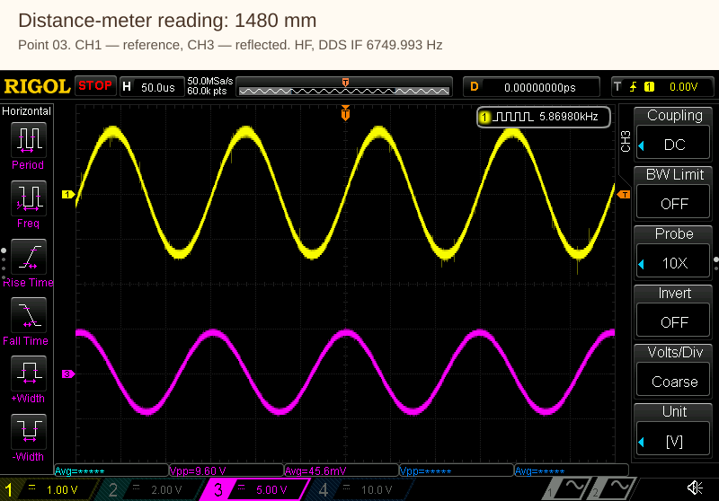

# LaserRangefinder — exploring distance through the phase of light

[Русский](README.md) | **English**

Repository: [neuroandriyanov/LaserRangefinder](https://github.com/neuroandriyanov/LaserRangefinder).

**A dual-frequency FPGA laser rangefinder and the bench on which we learn to measure and configure it.**

This repository brings together custom electronics, Verilog code, a desktop application,
schematics, photographs and real measurements. The project is developed jointly by a human
and AI: from restoring the optics and taking the first oscilloscope captures to phase-meter
algorithms, frequency selection and checking calibrated distance estimates.

*The custom board in its enclosure. The restored optical assembly is in the centre.
[More photographs](hardware/photos/README.en.md).*

## Where to start

| I want to… | Go to |
|---|---|
| Learn where the project came from | [Restoration and development story](docs/project-story.en.md) |
| Understand the measurement | [Architecture and data flow](docs/architecture.en.md) |
| See the bench and connections | [Bench equipment and setup](docs/stand.en.md) |
| See the results | [Experiments](docs/experiments.en.md) · [Latest series](measurements/2026-11-03/README.en.md) |
| Download the spreadsheet with formulas | [Excel: distances and errors](measurements/2026-11-03/Bench%20measurements.en.xlsx) |
| Study the signals | [20 oscilloscope captures with distances](measurements/2026-11-03/Осциллограммы/README.en.md) |
| Run the application | [Application and installation](app/README.en.md) |
| Build the firmware | [Quartus and HDL tests](fpga/README.en.md) |
| Explore the hardware | [Schematics and bill of materials](hardware/README.en.md) · [Photos](hardware/photos/README.en.md) |
| Continue with my own AI | [Getting started](docs/START_WITH_AI.en.md) · [AGENTS.en.md](AGENTS.en.md) |

## How it began

Studying the phase method required a device whose signals could be observed and whose
processing could be changed. The starting point was the optics of a faulty **LE-200 PROFIBUS**:
the lens, collimator and receiver assembly with SA612 mixers. The damaged original
electronics could not be restored. Faulty PIN photodiodes were replaced with **BPX65**
devices, and the laser diode with a **QL67D7SA**, in the red region around 670 nm.

After restoring the optical section, a new board was designed. It provides convenient
oscilloscope connection points, so the analogue signal path can be observed and compared
directly with the FPGA calculations. The enclosure was selected with IP68 protection and
future equipment trials in mind; the assembled device's protection rating has not yet
been confirmed by a dedicated test.

[Story and photographs of the optical assembly →](docs/project-story.en.md)

## How distance is measured

The laser is modulated at two frequencies simultaneously. One photodiode receives
reference light directly from the emitter through an optical fibre; the other receives
the reflection from the target. Mixers shift the signals down to a few kilohertz while
preserving their phase difference. Four sine waves and four comparator-derived digital
signals reach the FPGA.

The high frequency provides sensitivity to small distance changes. The low frequency
helps select the correct cycle of the high-frequency phase. We compare two measurement
methods: processing ADC samples and measuring the arrival time of digital edges.

| Part | Implementation |
|---|---|
| FPGA | Cyclone IV E, EP4CE6E22C8 |
| Signal generation | AD9959, four configurable outputs |
| Digitisation | Eight ADS8681 devices, synchronous sampling |
| Analogue phase | Sinusoidal least-squares fitting and CORDIC, without FIR |
| Digital phase | 125 MHz counter, edge accumulation |
| PC connection | USB–TTL, UART v3 with CRC and a common DDS update |
| Distance reference | Vector60 laser distance meter |
| Signal observation | Four-channel RIGOL DS1104Z |

Details are in the [signal-path description](docs/architecture.en.md) and
[communication protocol](docs/protocol-v3.en.md).

## How we worked with AI

Sergey assembled and restored the hardware, connected the instruments, moved the target
and checked the device's behaviour. AI helped interpret the schematic, write Verilog
and the desktop application, prepare simulations, run builds, read instruments through
the available interfaces and compare the results.

Experiments proceeded in steps: record with the target stationary, request a move,
confirm that it has stopped, then record again. Distance-meter readings, FPGA phases
and amplitudes, and later oscilloscope screenshots were saved together. Algorithm
discussions could therefore refer to concrete data.

Not every change helped. For example, the tested FIR did not produce a noticeable
improvement according to the author's observations, and was removed. Frequency and
amplitude selection produced a working profile for subsequent measurements, but we
do not regard it as a universal optimum. Decisions and open questions are preserved
so that the work can continue.

**To start with your own AI, open the project root and ask it to read
[AGENTS.en.md](AGENTS.en.md).** A ready-to-use first task and the procedure are in
the [guide](docs/START_WITH_AI.en.md). A useful contribution can start with one plot,
a hypothesis check or an improvement to the documentation.

## Measurements and current stage

The latest series contains **10 stationary target positions, from 762 to 5635 mm**.
Two screenshots were saved at each point: the reference and reflected HF signals,
followed by the equivalent LF pair. The workbook contains distance-meter readings,
FPGA data, calculated distances and errors relative to the distance meter.

*Reference and reflected signals after the mixers. The caption is outside the
native screenshot; the measurement traces have not been redrawn.*

At the nine points inside the cal2 range, the RMS discrepancy against the distance
meter was **13.36 mm for ADC-based phase and 13.16 mm for digital phase**. The
coefficients were fixed before this series. This is the averaged result of this bench,
not a rated rangefinder accuracy. The 5635 mm point is outside the calibration range
and carries the digital-overflow diagnostic flag; the report identifies it explicitly.

Distance is currently calculated by the desktop application. Moving distance and speed
calculation to the FPGA, investigating rare faults, motion and temperature effects are
the next tasks. Full testing at **100–200 m** needs a long site, such as a corridor
around 200 m long. Current tests are limited to a small room.

[Report and spreadsheet →](measurements/2026-11-03/README.en.md) ·
[Experiment map →](docs/experiments.en.md) ·
[What remains untested →](docs/known-limitations.en.md)

## Try it without hardware

After installing Python with Tcl/Tk, run from the project root:

~~~powershell
powershell -ExecutionPolicy Bypass -File app/install.ps1
app/Run.cmd --demo
~~~

Tested on Windows with Python 3.14 x64. Demo mode does not access instruments.
To use a board, choose your own COM port; DDS settings are sent using the button.
[Detailed installation and distance-meter connection](app/README.en.md).

## Materials and continuing the work

The app/, fpga/, hardware/ and measurements/ folders can be studied separately.
The package includes build instructions, tests, a saved working image and
[portability verification results](docs/build-verification.en.md).
Photographs and measurements have provenance and checksums. A
[link catalogue](docs/website-links.en.md) is available for presenting the materials
on a website.

The purpose of this publication is to share the investigation as well as the code:
how the bench is arranged, what we tried, what worked and what remains unresolved.
If you can measure over a longer distance, compare processing methods or suggest
an improvement, these materials provide a checked starting point.

## Other projects by the author

- [FerroDSP](https://github.com/neuroandriyanov/FerroDsp/blob/main/README.en.md) — an experimental ADAU1452 metal detector with custom electronics and SigmaStudio algorithms.
- [PropValve-RE06MT](https://github.com/neuroandriyanov/PropValve-RE06MT/blob/main/README.en.md) — external proportional-valve control electronics based on ADAU1701.

The common approach is custom hardware, observable signals and development that
can be continued with AI using the saved materials.

## Licences

Original code, documentation, photographs and measurement materials: **MIT**.
Original electrical schematics and bill of materials: **CERN-OHL-P-2.0**.
The scope and exclusions for manufacturer materials are described in
[NOTICE.en.md](NOTICE.en.md). Full texts: [MIT](LICENSE),
[CERN-OHL-P-2.0](LICENSES/CERN-OHL-P-2.0.txt).

Hardware author: Sergey Andriyanov ([NeuroAndriyanov](https://github.com/neuroandriyanov)).
Code, measurement scripts and documentation were developed jointly with AI.

New materials can be published in Russian first, with translations added later.
[Translation workflow and freshness checks](docs/TRANSLATIONS.en.md).
