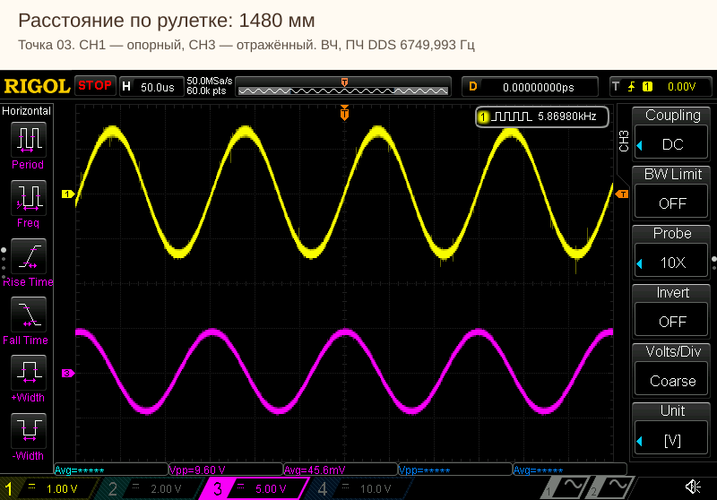

# LaserRangefinder — исследуем расстояние по фазе света

Репозиторий: [neuroandriyanov/LaserRangefinder](https://github.com/neuroandriyanov/LaserRangefinder).

**Двухчастотный лазерный дальномер на FPGA и стенд, на котором мы учимся его измерять и настраивать.**

Здесь собраны собственная электроника, код Verilog, программа для ПК, схемы,
фотографии и реальные измерения. Проект развивается в совместной работе человека
и ИИ: от восстановления оптики и первых осциллограмм до алгоритмов фазометра,
подбора частот и проверки расстояния по калибровке.

*Собственная плата в корпусе. В центре — узел восстановленной оптической системы.
[Больше фотографий](hardware/photos/README.md).*

## С чего начать

| Хочется… | Куда перейти |
|---|---|
| Узнать, откуда взялся проект | [История восстановления и разработки](docs/project-story.md) |
| Разобраться в измерении | [Устройство и поток данных](docs/architecture.md) |
| Посмотреть стенд и подключения | [Из чего состоит стенд](docs/stand.md) |
| Увидеть результаты | [Эксперименты](docs/experiments.md) · [Последняя серия](measurements/2026-11-03/README.md) |
| Скачать таблицу с формулами | [Excel: расстояния и ошибки](measurements/2026-11-03/Стендовые%20измерения.xlsx) |
| Изучить сигналы | [20 осциллограмм с расстояниями](measurements/2026-11-03/Осциллограммы/README.md) |
| Запустить программу | [Приложение и установка](app/README.md) |
| Собрать прошивку | [Quartus и HDL-тесты](fpga/README.md) |
| Посмотреть аппаратуру | [Схемы и спецификация](hardware/README.md) · [Фото](hardware/photos/README.md) |
| Продолжить работу со своим ИИ | [Начало работы](docs/START_WITH_AI.md) · [AGENTS.md](AGENTS.md) |

## Как всё началось

Для исследования фазового метода понадобился прибор, в котором можно наблюдать
сигналы и менять обработку. Основой стала оптика неисправного **LE-200 PROFIBUS**:
линза, коллиматор и приёмный блок со смесителями SA612. Повреждённая штатная
электроника не подлежала восстановлению. Неисправные PIN-фотодиоды заменены
на **BPX65**, лазерный диод — на **QL67D7SA**, для красного диапазона около 670 нм.

После восстановления оптической части была разработана новая плата. На ней
предусмотрены удобные точки подключения осциллографа: можно видеть, что происходит
в аналоговом тракте, и сразу сравнивать это с вычислениями FPGA. Корпус выбирался
с расчётом на защиту IP68 и будущие испытания на оборудовании; степень защиты
собранного устройства отдельным испытанием пока не подтверждена.

[История и фотографии оптического узла →](docs/project-story.md)

## Как измеряется расстояние

Лазер одновременно модулируется двумя частотами. Один фотодиод получает опорный
свет непосредственно от излучателя по оптоволокну, второй — отражение от мишени.
Смесители переносят сигналы в область нескольких килогерц, сохраняя информацию
о разности фаз. На FPGA поступают четыре синусоиды и четыре цифровых сигнала
после компараторов.

Высокая частота даёт чувствительность к небольшому изменению расстояния.
Низкая помогает выбрать нужный оборот высокой фазы. Мы сравниваем два способа
измерения: обработку отсчётов АЦП и время прихода цифровых фронтов.

| Часть | Что используется |
|---|---|
| FPGA | Cyclone IV E, EP4CE6E22C8 |
| Формирование сигналов | AD9959, четыре настраиваемых выхода |
| Оцифровка | Восемь ADS8681, синхронная выборка |
| Аналоговая фаза | Синусоидальный МНК и CORDIC, без FIR |
| Цифровая фаза | Счётчик 125 МГц, накопление по фронтам |
| Связь с ПК | USB–TTL, UART v3 с CRC и общим обновлением DDS |
| Контроль расстояния | Лазерная рулетка Vector60 |
| Наблюдение сигналов | Четырёхканальный RIGOL DS1104Z |

Подробности — в [описании тракта](docs/architecture.md) и [протоколе обмена](docs/protocol-v3.md).

## Как мы работали вместе с ИИ

Сергей собрал и восстановил аппаратную часть, подключал приборы, перемещал мишень
и проверял поведение устройства. ИИ помогал разбирать схему, писать Verilog
и программу ПК, готовить моделирование, запускать сборки, считывать приборы
через доступные интерфейсы и сопоставлять результаты.

Эксперименты проводились по шагам: запись на неподвижной мишени, команда
переместить её, подтверждение остановки, следующая запись. Вместе сохранялись
показания рулетки, фазы и амплитуды FPGA, а затем и снимки осциллографа.
Так обсуждение алгоритма опиралось на конкретные данные.

Не каждое изменение помогало. Например, испытанный FIR не дал заметного
улучшения по наблюдениям автора и был убран. Подбор частот и амплитуд дал
рабочий профиль для следующих измерений, но мы не считаем его универсальным
оптимумом. История решений и открытые вопросы оставлены для продолжения работы.

**Чтобы начать со своим ИИ, откройте корень проекта и дайте ему прочитать
[AGENTS.md](AGENTS.md).** Готовое первое задание и порядок действий находятся
в [инструкции](docs/START_WITH_AI.md). Полезный вклад может начинаться с одного
графика, проверки гипотезы или улучшения документации.

## Измерения и текущий этап

Последняя серия — **10 неподвижных положений мишени, от 762 до 5635 мм**.
Для каждой точки сохранены два снимка: опорный и отражённый ВЧ-сигналы,
затем такая же пара НЧ. В Excel находятся показания рулетки, данные FPGA,
рассчитанное расстояние и ошибка относительно рулетки.

*Опорный и отражённый сигналы после смесителей. Подпись находится за пределами
нативного снимка; измерительные следы не перерисованы.*

На девяти точках внутри диапазона cal2 RMS расхождения с рулеткой составил
**13,36 мм по АЦП и 13,16 мм по цифровым фазам**. Коэффициенты были зафиксированы
до этой серии. Это результат данного стенда после усреднения, а не паспортная
точность дальномера. Точка 5635 мм находится вне калибровки и содержит
диагностический флаг цифрового переполнения — в отчёте это отмечено.

Дальность пока рассчитывает программа ПК. Перенос расчёта расстояния и скорости
в FPGA, исследование редких сбоев, динамики и температурного влияния — следующие
задачи. Для полноценной проверки на **100–200 м** нужен длинный участок,
например коридор около 200 м. Сейчас испытания ограничены небольшим помещением.

[Отчёт и таблица →](measurements/2026-11-03/README.md) ·
[Карта экспериментов →](docs/experiments.md) ·
[Что ещё не проверено →](docs/known-limitations.md)

## Попробовать без аппаратуры

После установки Python с Tcl/Tk выполните из корня проекта:

~~~powershell
powershell -ExecutionPolicy Bypass -File app/install.ps1
app/Run.cmd --demo
~~~

Проверено на Windows и Python 3.14 x64. Деморежим не обращается к приборам.
Для работы с платой выберите свой COM-порт; DDS отправляется по кнопке.
[Подробная установка и подключение рулетки](app/README.md).

## Материалы и продолжение

Папки app/, fpga/, hardware/ и measurements/ можно изучать отдельно.
В комплекте есть инструкции сборки, тесты, сохранённый рабочий образ и
[результаты проверки переносимости](docs/build-verification.md).
Фотографии и измерения снабжены происхождением и контрольными суммами.
Для размещения материалов на сайте подготовлен [каталог ссылок](docs/website-links.md).

Смысл этой публикации — поделиться не только кодом, но и ходом исследования:
как устроен стенд, что мы пробовали, что получилось и какие вопросы остались.
Если у вас есть возможность провести измерения на большей дистанции,
сравнить обработку или предложить улучшение, материалы помогут начать
с уже проверенной точки.

## Другие проекты автора

- [FerroDSP](https://github.com/neuroandriyanov/FerroDsp) — экспериментальный металлоискатель на ADAU1452, собственная электроника и алгоритмы SigmaStudio.
- [PropValve-RE06MT](https://github.com/neuroandriyanov/PropValve-RE06MT) — выносная электроника управления пропорциональным клапаном на ADAU1701.

Общий подход — собственная аппаратура, наблюдаемые сигналы и разработка,
которую можно продолжить вместе с ИИ по сохранённым материалам.

## Лицензии

Авторский код, документация, фотографии и материалы измерений — **MIT**.
Оригинальные электрические схемы и спецификация — **CERN-OHL-P-2.0**.
Область действия и исключения для материалов производителей описаны в
[NOTICE.md](NOTICE.md). Полные тексты: [MIT](LICENSE),
[CERN-OHL-P-2.0](LICENSES/CERN-OHL-P-2.0.txt).

Автор аппаратуры — Сергей Андриянов ([NeuroAndriyanov](https://github.com/neuroandriyanov)).
Код, измерительные сценарии и описание развивались совместно с ИИ.
