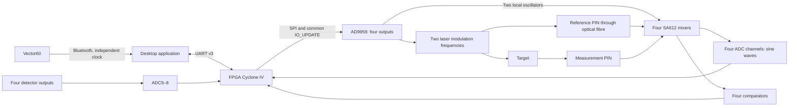

# Architecture and data flow

[Русский](architecture.md) | **English**

Two modulation frequencies are summed in the laser path. The reference PIN photodiode
receives part of the emitted light through an optical fibre; the measurement photodiode
receives the target reflection. Four external SA612 mixers mix both signals with two
local oscillators. The meter inputs therefore receive two reference and two reflected
intermediate-frequency (IF) sine waves.

The FPGA samples the ADCs synchronously and calculates both analogue phase differences.
Least-squares fitting estimates the sine, cosine and DC components at the known IF;
CORDIC produces phase and amplitude. A separate digital path averages edge phases.
The IF and expected digital periods are updated from the same accepted DDS bank.
During retuning, data is marked invalid and the measurement windows are then refilled.

The application matches stationary intervals to the distance meter and builds a
calibration. Coarse LF phase selects the HF cycle number, while the precise component
comes from HF phase with an experimental correction. Cal2 uses a degree-4 polynomial.
The oscilloscope screenshot, distance-meter reading and FPGA packet are acquired at
different times: there is no hardware synchronisation between these three instruments.
