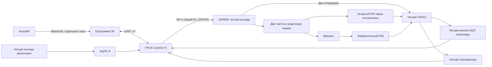

# Устройство и поток данных

**Русский** · [English](architecture.en.md)

Две модуляционные частоты суммируются в лазерном тракте. Опорный PIN-фотодиод
получает часть излучения по оптоволокну; измерительный — отражение от мишени.
Четыре внешних SA612 смешивают оба сигнала с двумя гетеродинами.
На входах измерителя получаются две опорные и две отражённые синусоиды ПЧ.

FPGA синхронно оцифровывает АЦП и вычисляет обе аналоговые фазовые разности.
МНК оценивает синус, косинус и постоянную составляющую на известной ПЧ;
CORDIC даёт фазу и амплитуду. Отдельный цифровой тракт усредняет фазы фронтов.
ПЧ и цифровые ожидаемые периоды обновляются из того же принятого банка DDS.
Во время перестройки данные помечаются непригодными, затем окна набираются заново.

Программа сопоставляет неподвижные интервалы с рулеткой и строит калибровку.
Грубая НЧ-фаза выбирает номер оборота ВЧ, точная составляющая определяется
ВЧ-фазой с экспериментальной поправкой. В cal2 используется полином степени 4.
Снимок осциллографа, рулетка и пакет FPGA имеют разные моменты получения:
аппаратной синхронизации между этими тремя приборами нет.
