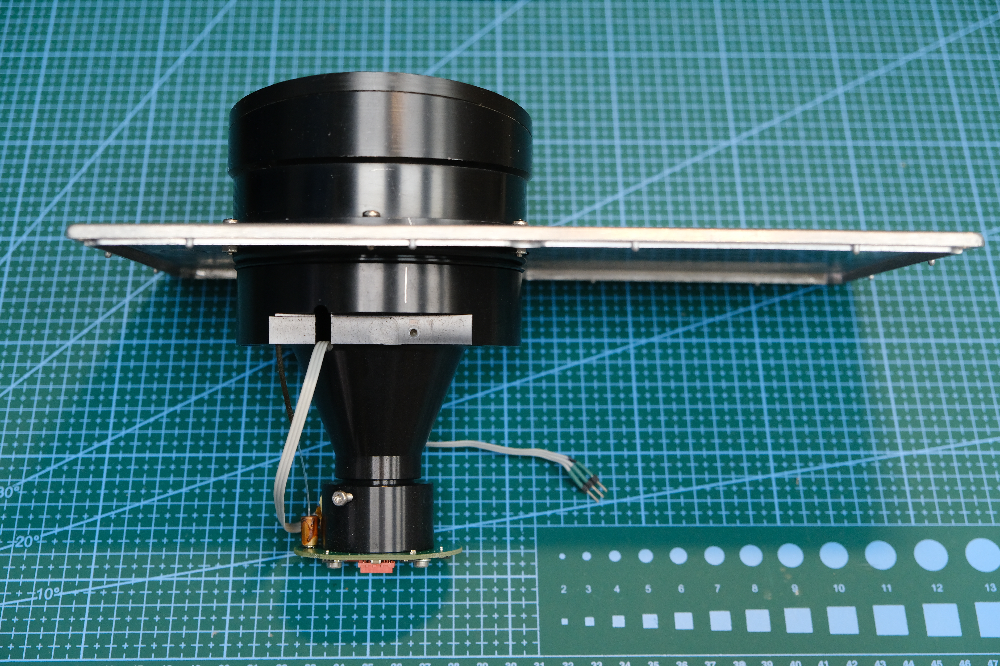

# From a faulty rangefinder to a research bench

[Русский](project-story.md) · **English**

This project began with a desire to understand phase-based distance measurement in a real optical path. That required a design where an oscilloscope could be connected, frequencies and amplitudes changed, ADC samples read and different phase-calculation methods compared.

## A second life for the optics

The donor was a faulty **LE-200 PROFIBUS**. According to the author, its original boards were damaged beyond repair. The optical system with lens and collimator and the receiver assembly with SA612 mixers were reused in the new design.

Failed PIN photodiodes were replaced with **BPX65** devices; the author separately confirmed this part number. The laser diode also required replacement: a **QL67D7SA** was fitted, selected for red emission around **670 nm**. This replacement history is the author's account; no spectral measurement was performed in the published experiments.

*Optical assembly and mounting. [Original photograph](../hardware/photos/rangefinder-03.jpg).*

## New electronics for observation and experiments

After restoring the optics, an enclosure was selected and a custom board designed. Particular attention went to debugging: connection points allow observation of four analogue signals after the mixers and their corresponding comparator signals. A single change can therefore be followed on both the oscilloscope screen and in FPGA numbers.

AD9959 generates two modulation frequencies and two local oscillators. The FPGA controls DDS, reads eight ADCs synchronously and measures phases using analogue and digital methods. The desktop application configures parameters and saves results.

The enclosure was selected with IP68 protection in mind, for later testing on equipment under operating conditions. This is a design goal: the package does not yet contain a separate protection-rating test report for the assembled rangefinder.

## Human and AI collaboration

Sergey restored, designed and assembled the hardware. He defined the device's purpose, clarified actual connections, connected instruments and moved the target. AI helped examine documents and code, calculate signal processing, write Verilog and prepare the desktop application, tests and measurement procedures.

Work progressed in small, verifiable stages: DDS control first, then synchronous ADC reading and analogue phases, the digital phase meter, COM requests, frequency and amplitude selection, calibration and a separate verification series. Settings, primary data and build results were saved between changes.

In manual-target experiments, the agent recorded a point and issued the next instruction. Sergey moved the target, confirmed that it had stopped and waited for recording to finish. The distance meter provided a reference distance, the oscilloscope displayed waveform shape, and UART allowed comparison with FPGA calculations.

Some approaches did not work. FIR before phase calculation showed no noticeable improvement according to the author's observations, so it is absent from the current version. Rare jumps and the digital-overflow flag remain subjects of investigation; code inspection and a successful build alone do not establish their cause.

## Why keep this open

We want to share the development process: bench architecture, measurements, verified solutions and unanswered questions. This package helps the next participant start from a working foundation and contribute experience, and gives an AI assistant context through documents instead of retelling the full story.

Only a small room is currently available, so the latest series ends at 5635 mm. Fully verifying the intended 100–200 m range requires a long space, such as a corridor about 200 m long, and a new measurement series. Room-scale results do not yet extend to that distance.

[Bench equipment](stand.en.md) · [Experiments](experiments.en.md) · [Continuing with AI](START_WITH_AI.en.md)

*Hardware history was recorded on 03.11.2026 from the author's account. The current-code and results descriptions are based on project sources and saved checks.*
