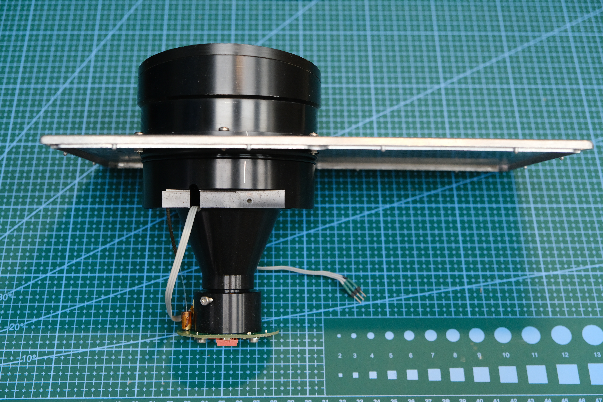

# От неисправного дальномера к исследовательскому стенду

**Русский** · [English](project-story.en.md)

Этот проект начался с желания разобраться в фазовом измерении расстояния
на реальном оптическом тракте. Для этого понадобилась конструкция, в которой
можно подключить осциллограф, менять частоты и амплитуды, получать отсчёты АЦП
и сравнивать разные способы вычисления фазы.

## Вторая жизнь оптики

Донором стал неисправный **LE-200 PROFIBUS**. По рассказу автора, его штатные
платы были повреждены и не подлежали ремонту. Для новой конструкции использованы
оптическая система с линзой и коллиматором и приёмный блок со смесителями SA612.

Неисправные PIN-фотодиоды заменены на **BPX65**; эту маркировку автор отдельно
подтвердил. Лазерный диод тоже потребовал замены: установлен **QL67D7SA**,
выбранный для красного излучения около **670 нм**. История замены приведена
со слов автора; измерение спектра в опубликованных опытах не проводилось.

*Оптический узел и его монтаж. [Оригинал фотографии](../hardware/photos/rangefinder-03.jpg).* 

## Новая электроника для наблюдения и экспериментов

После восстановления оптики был выбран корпус и разработана собственная плата.
Особое внимание уделялось отладке: точки подключения позволяют наблюдать четыре
аналоговых сигнала после смесителей и соответствующие сигналы компараторов.
Поэтому одно изменение можно проследить и на экране осциллографа, и в числах FPGA.

AD9959 формирует две частоты модуляции и два гетеродина. FPGA управляет DDS,
синхронно читает восемь АЦП и измеряет фазы аналоговым и цифровым способами.
Программа ПК настраивает параметры и сохраняет результаты.

Корпус выбирался с расчётом на защиту IP68, чтобы позже проверить устройство
на оборудовании в рабочих условиях. Это цель конструкции: отдельного протокола
испытаний степени защиты собранного дальномера в комплекте пока нет.

## Совместная работа человека и ИИ

Аппаратуру восстанавливал, разрабатывал и собирал Сергей. Он задавал назначение
устройства, уточнял реальные соединения, подключал приборы и перемещал мишень.
ИИ помогал разбирать документы и код, рассчитывать обработку, писать Verilog,
подготавливать приложение ПК, тесты и измерительные сценарии.

Работа шла небольшими проверяемыми этапами. Сначала управление DDS, затем
синхронное чтение АЦП и аналоговые фазы, цифровой фазомер, запросы по COM,
подбор частот и амплитуд, калибровка и отдельная проверочная серия. Между
изменениями сохранялись настройки, исходные данные и результаты сборок.

В опытах с ручной мишенью агент снимал точку и давал следующую команду.
Сергей перемещал мишень, подтверждал остановку и ждал завершения записи.
Рулетка служила ориентиром расстояния, осциллограф показывал форму сигналов,
а UART позволял сравнивать это с вычислениями FPGA.

Были и неудачные направления. FIR перед фазовым расчётом не дал заметного
улучшения по наблюдениям автора, поэтому в актуальной версии его нет.
Редкие скачки и цифровой флаг переполнения остаются предметом исследования;
проверка кода и успешная сборка сами по себе не устанавливают их причину.

## Зачем сохранять это открыто

Мы хотим поделиться ходом разработки: устройством стенда, измерениями,
проверенными решениями и вопросами, на которые ещё нет ответа. Такой комплект
поможет следующему участнику начать с работающей основы и предложить свой опыт,
а своему ИИ — передать контекст через документы, а не пересказывать всю историю.

Сейчас доступно небольшое помещение, поэтому последняя серия заканчивается
на 5635 мм. Для полноценной проверки предполагаемого диапазона 100–200 м
нужен длинный участок, например коридор около 200 м, и новая серия измерений.
Пока результаты комнатного стенда не переносятся на эту дальность.

[Состав стенда](stand.md) · [Эксперименты](experiments.md) ·
[Как продолжить с ИИ](START_WITH_AI.md)

*История аппаратуры записана 03.11.2026 со слов автора. Описание текущего кода
и результатов опирается на исходники и сохранённые проверки проекта.*
