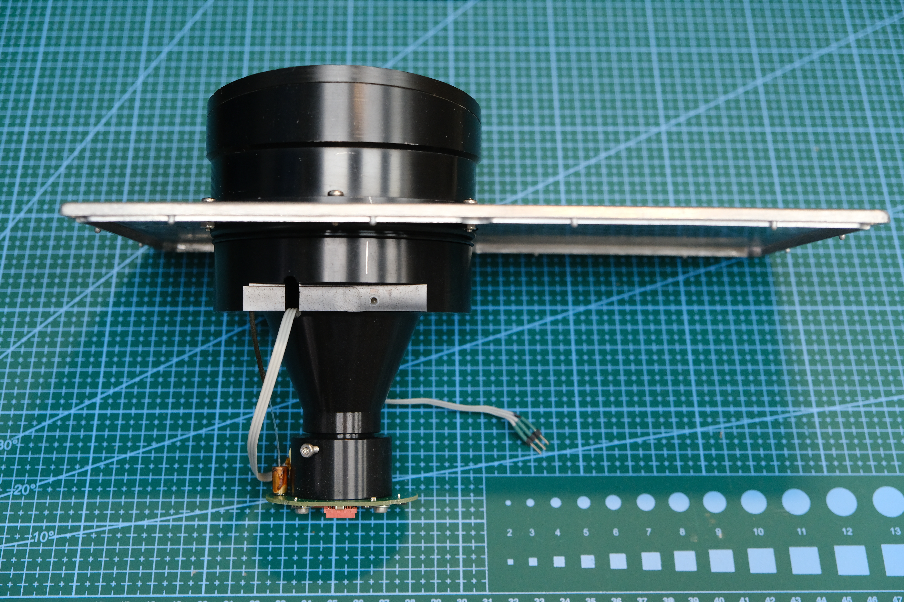

# Photographs of the rangefinder, optics and power supply

[Русский](README.md) · **English**

Original photographs by the author. Images are retained without re-encoding; links open full-resolution files. Board labels do not replace checking connections against the schematic and QSF.

## Board in the enclosure

*Custom electronics surround the optical assembly.*

## Optical assembly

*The optics used to build the bench. The restoration story is [described separately](../../docs/project-story.en.md).*

## All original photographs

| Rangefinder | Power supply |
|---|---|
| [Photograph 01 — board](rangefinder-01.jpg) | [Power supply 01](power-supply-01.jpg) |
| [Photograph 02](rangefinder-02.jpg) | [Power supply 02](power-supply-02.jpg) |
| [Photograph 03 — optical assembly](rangefinder-03.jpg) | |
| [Photograph 04](rangefinder-04.jpg) | |
| [Photograph 05 — board in enclosure](rangefinder-05.jpg) | |
| [Photograph 06](rangefinder-06.jpg) | |

Oscilloscope screenshots are stored separately: [latest series with distances](../../measurements/2026-11-03/Осциллограммы/README.en.md).
