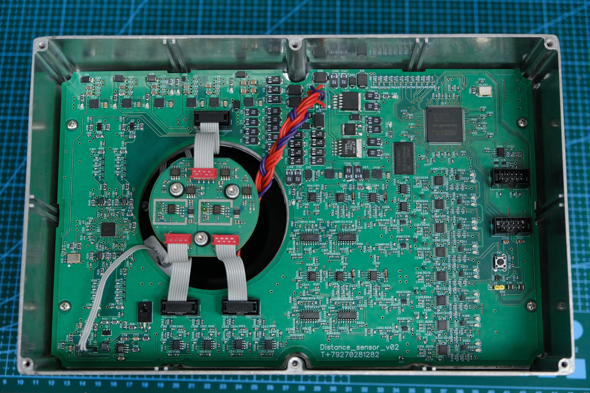
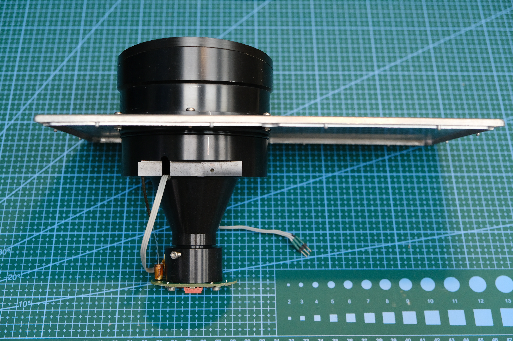

# Фотографии дальномера, оптики и питания

**Русский** | [English](README.en.md)

Оригинальные фотографии автора. Изображения сохранены без перекодирования;
по ссылкам открываются полноразмерные файлы. Надписи на плате не заменяют
проверку соединений по схеме и QSF.

## Плата в корпусе

*Собственная электроника размещена вокруг оптического узла.*

## Оптический узел

*Оптика, использованная при создании стенда. История восстановления —
[в отдельном описании](../../docs/project-story.md).* 

## Все исходные снимки

| Дальномер | Питание |
|---|---|
| [Снимок 01 — плата](rangefinder-01.jpg) | [Снимок питания 01](power-supply-01.jpg) |
| [Снимок 02](rangefinder-02.jpg) | [Снимок питания 02](power-supply-02.jpg) |
| [Снимок 03 — оптический узел](rangefinder-03.jpg) | |
| [Снимок 04](rangefinder-04.jpg) | |
| [Снимок 05 — плата в корпусе](rangefinder-05.jpg) | |
| [Снимок 06](rangefinder-06.jpg) | |

Осциллограммы хранятся отдельно: [последняя серия с расстояниями](../../measurements/2026-11-03/Осциллограммы/README.md).
