# Waveforms by distance

[Русский](README.md) · **English**

Captions are outside the native image. PNG files preserve the original pixels; SVG files contain a caption and an embedded PNG.

## Point 01 — 762 mm

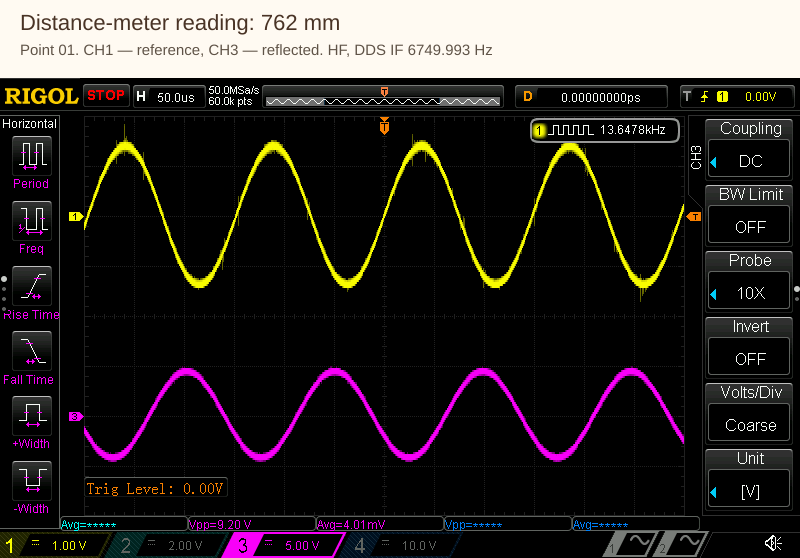

[Native PNG](point-01_00762.0mm_ch1-ch3.png)

[Native PNG](point-01_00762.0mm_ch2-ch4.png)

## Point 02 — 1091 mm

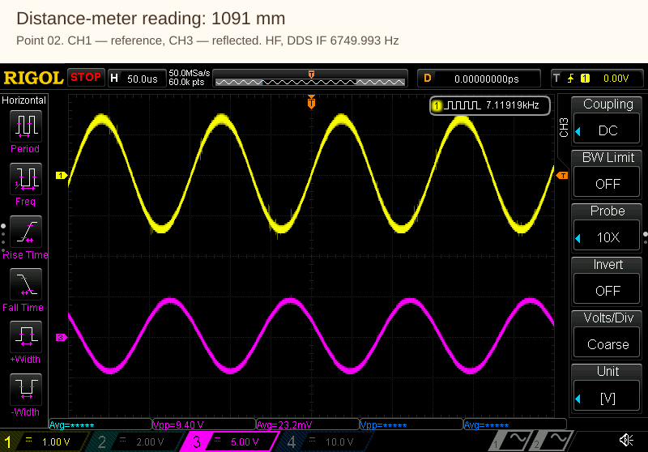

[Native PNG](point-02_01091.0mm_ch1-ch3.png)

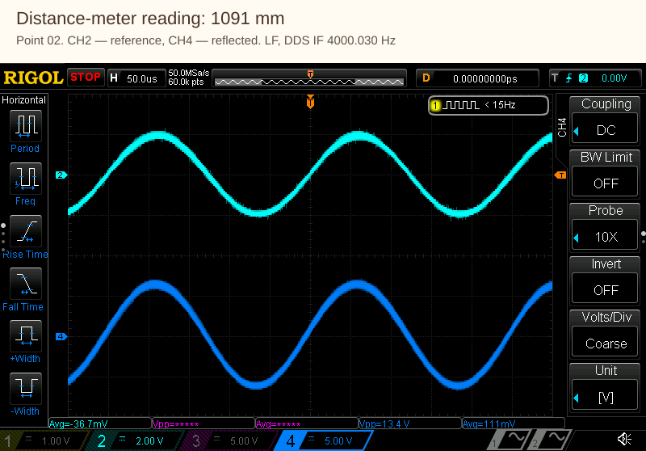

[Native PNG](point-02_01091.0mm_ch2-ch4.png)

## Point 03 — 1480 mm

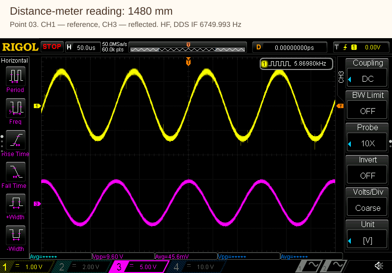

[Native PNG](point-03_01480.0mm_ch1-ch3.png)

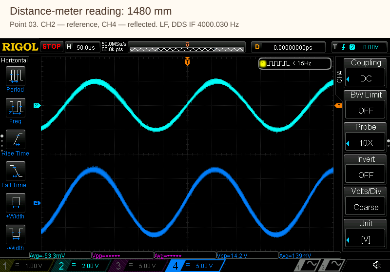

[Native PNG](point-03_01480.0mm_ch2-ch4.png)

## Point 04 — 1958 mm

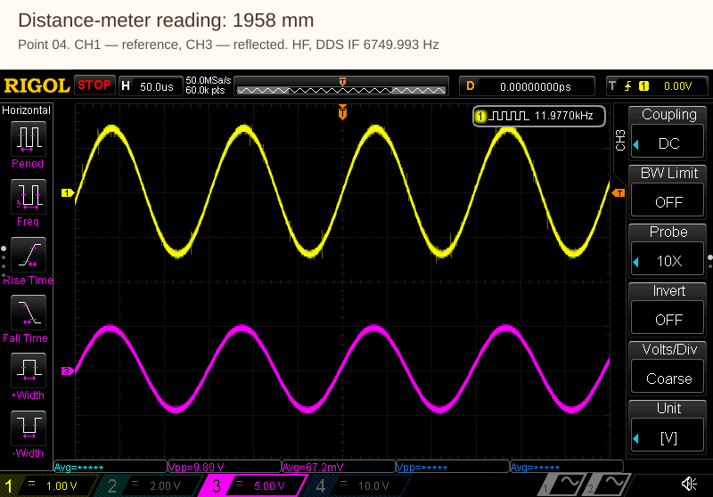

[Native PNG](point-04_01958.0mm_ch1-ch3.png)

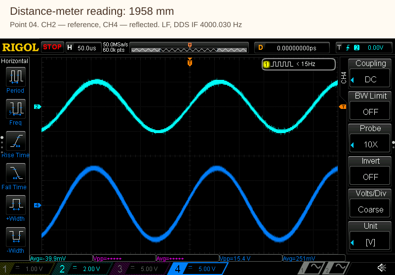

[Native PNG](point-04_01958.0mm_ch2-ch4.png)

## Point 05 — 2398 mm

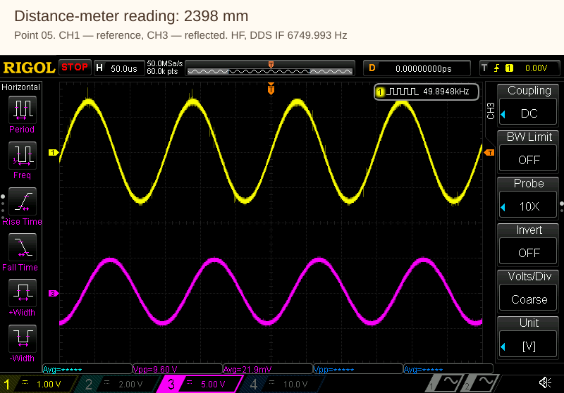

[Native PNG](point-05_02398.0mm_ch1-ch3.png)

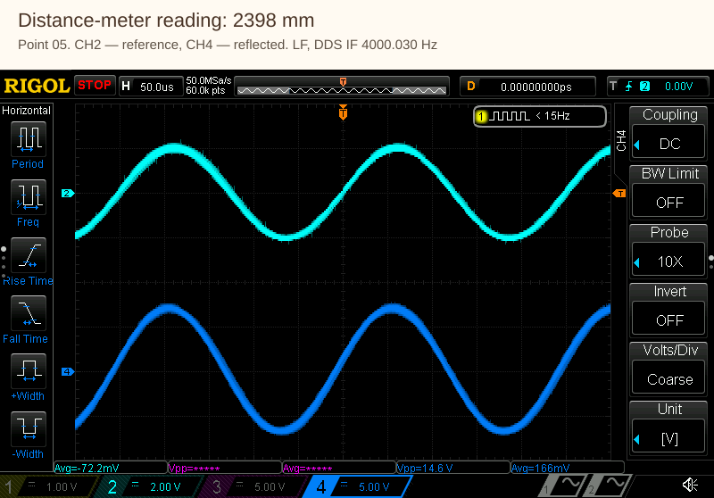

[Native PNG](point-05_02398.0mm_ch2-ch4.png)

## Point 06 — 2876 mm

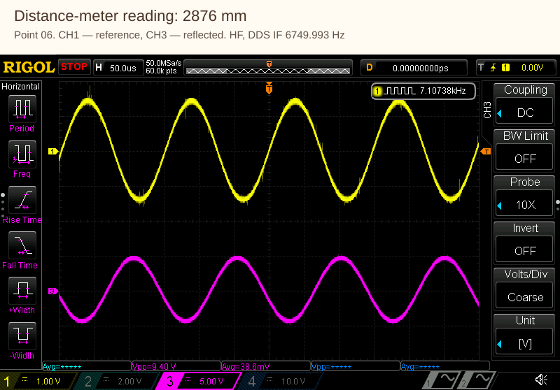

[Native PNG](point-06_02876.0mm_ch1-ch3.png)

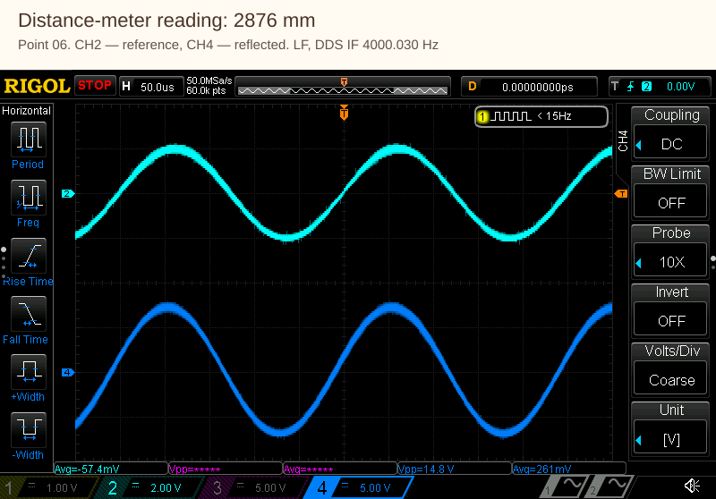

[Native PNG](point-06_02876.0mm_ch2-ch4.png)

## Point 07 — 3425 mm

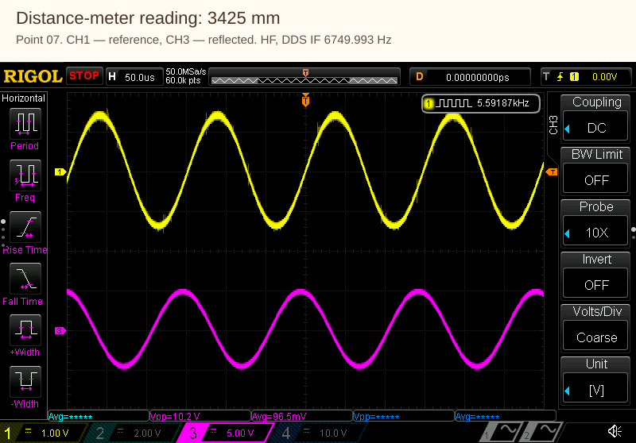

[Native PNG](point-07_03425.0mm_ch1-ch3.png)

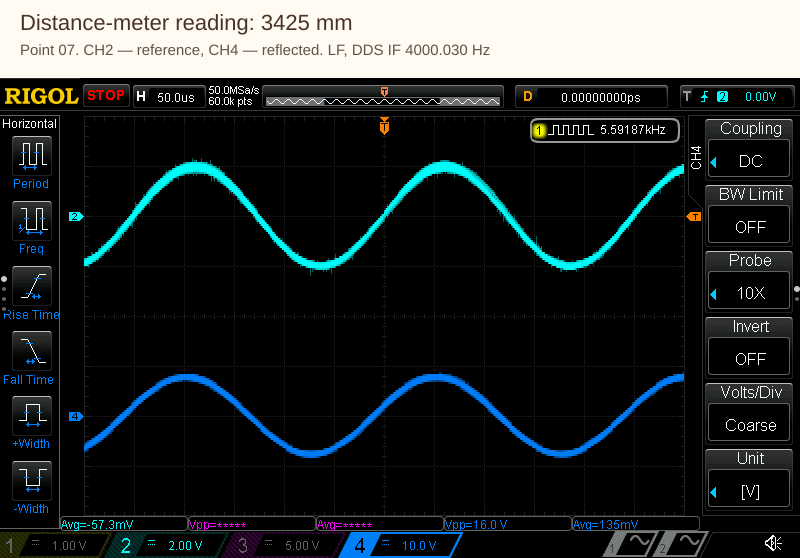

[Native PNG](point-07_03425.0mm_ch2-ch4.png)

## Point 08 — 4198 mm

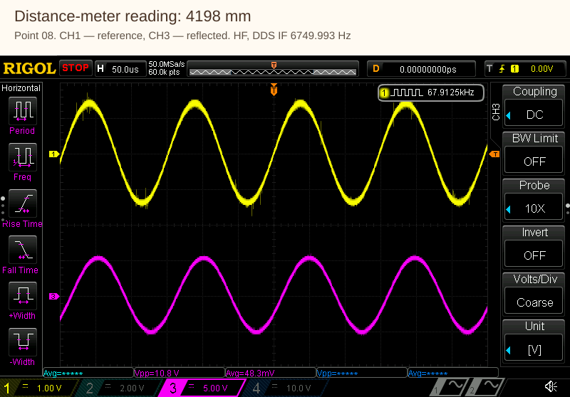

[Native PNG](point-08_04198.0mm_ch1-ch3.png)

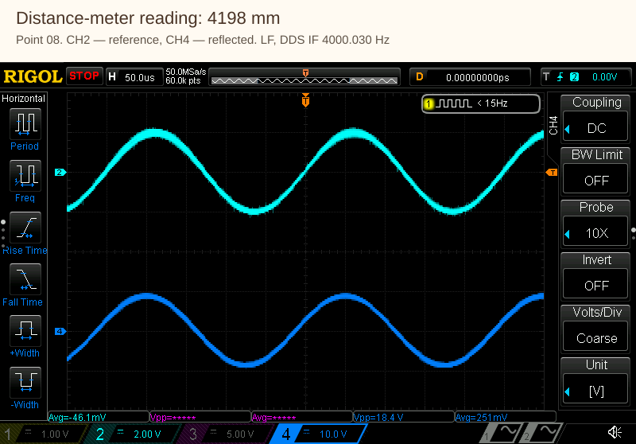

[Native PNG](point-08_04198.0mm_ch2-ch4.png)

## Point 09 — 4814 mm

[Native PNG](point-09_04814.0mm_ch1-ch3.png)

[Native PNG](point-09_04814.0mm_ch2-ch4.png)

## Point 10 — 5635 mm

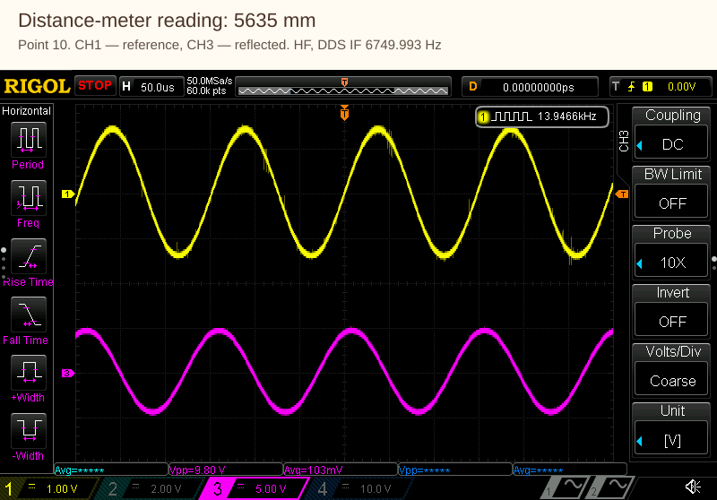

[Native PNG](point-10_05635.0mm_ch1-ch3.png)

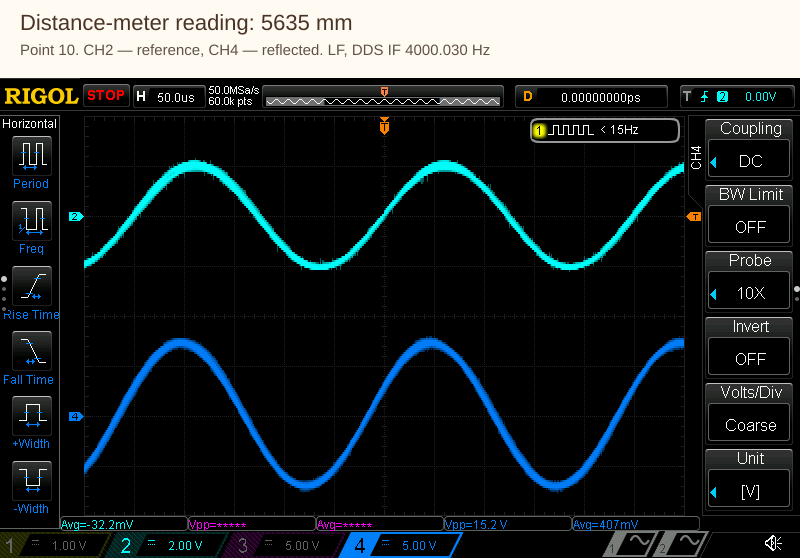

[Native PNG](point-10_05635.0mm_ch2-ch4.png)
