# Осциллограммы по расстояниям

**Русский** · [English](README.en.md)

Подписи находятся вне нативного изображения. PNG сохраняют исходные пиксели; SVG содержит подпись и встроенный PNG.

## Точка 01 — 762 мм

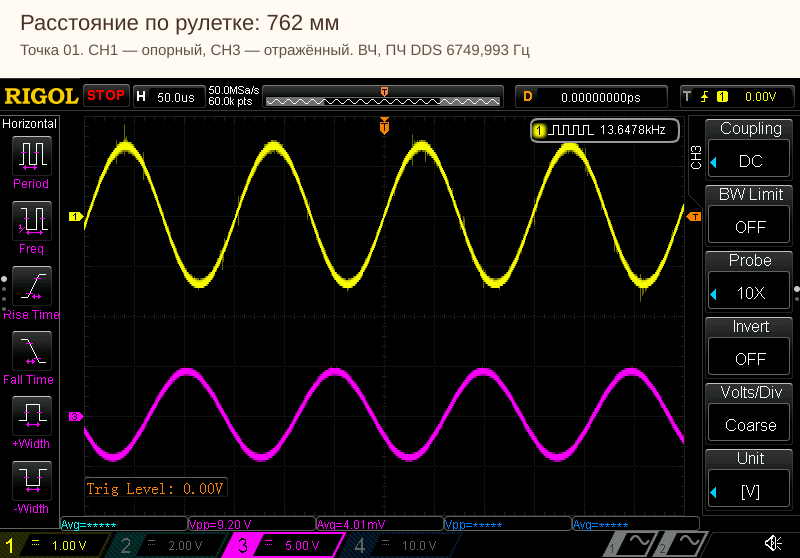

[Нативный PNG](point-01_00762.0mm_ch1-ch3.png)

[Нативный PNG](point-01_00762.0mm_ch2-ch4.png)

## Точка 02 — 1091 мм

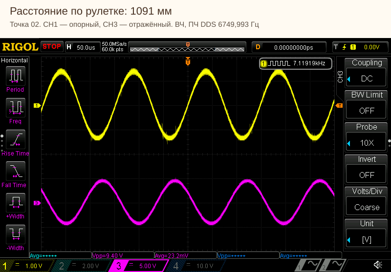

[Нативный PNG](point-02_01091.0mm_ch1-ch3.png)

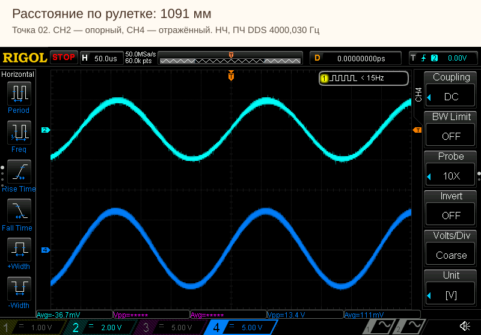

[Нативный PNG](point-02_01091.0mm_ch2-ch4.png)

## Точка 03 — 1480 мм

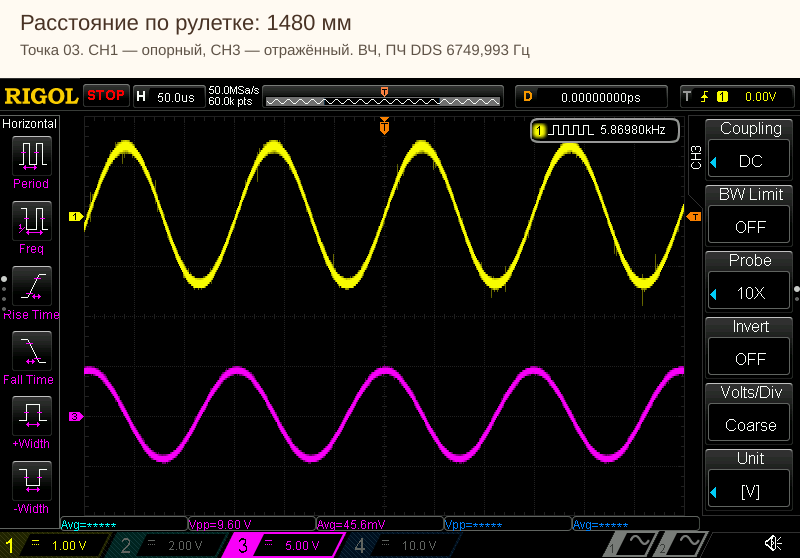

[Нативный PNG](point-03_01480.0mm_ch1-ch3.png)

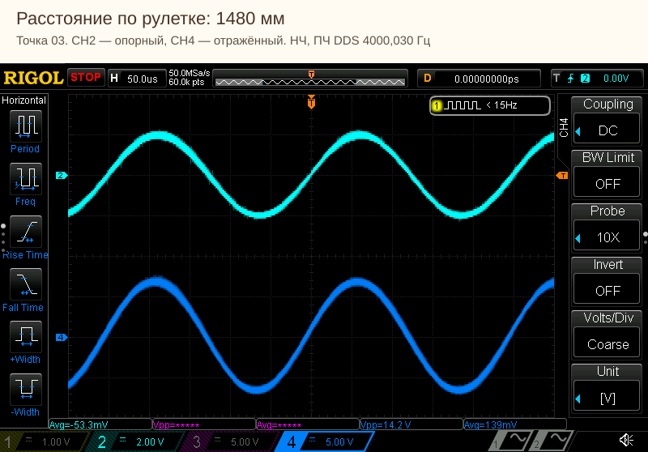

[Нативный PNG](point-03_01480.0mm_ch2-ch4.png)

## Точка 04 — 1958 мм

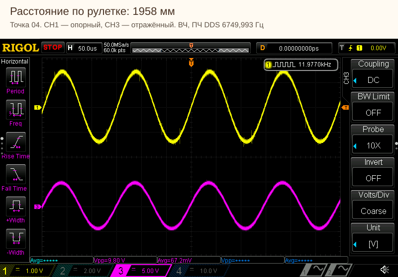

[Нативный PNG](point-04_01958.0mm_ch1-ch3.png)

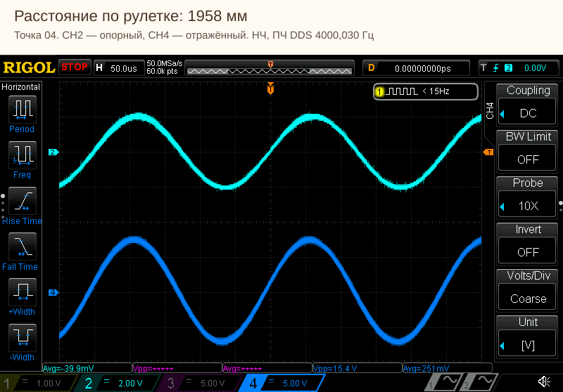

[Нативный PNG](point-04_01958.0mm_ch2-ch4.png)

## Точка 05 — 2398 мм

[Нативный PNG](point-05_02398.0mm_ch1-ch3.png)

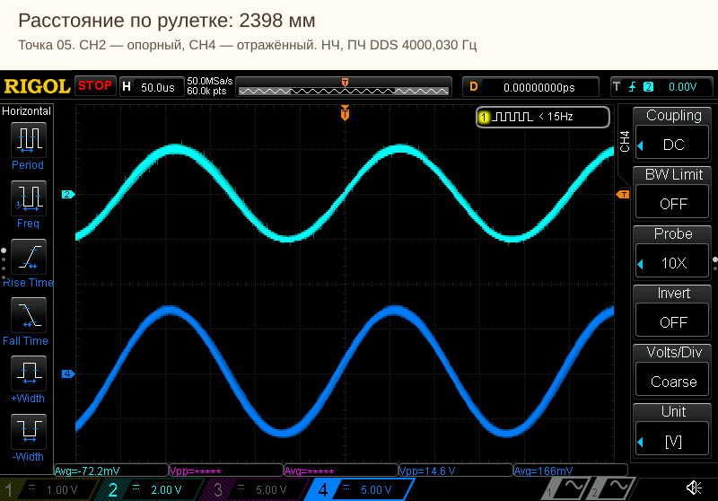

[Нативный PNG](point-05_02398.0mm_ch2-ch4.png)

## Точка 06 — 2876 мм

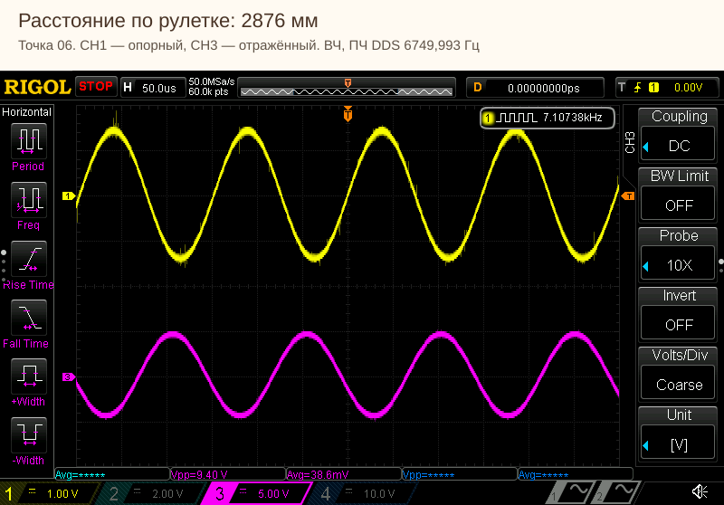

[Нативный PNG](point-06_02876.0mm_ch1-ch3.png)

[Нативный PNG](point-06_02876.0mm_ch2-ch4.png)

## Точка 07 — 3425 мм

[Нативный PNG](point-07_03425.0mm_ch1-ch3.png)

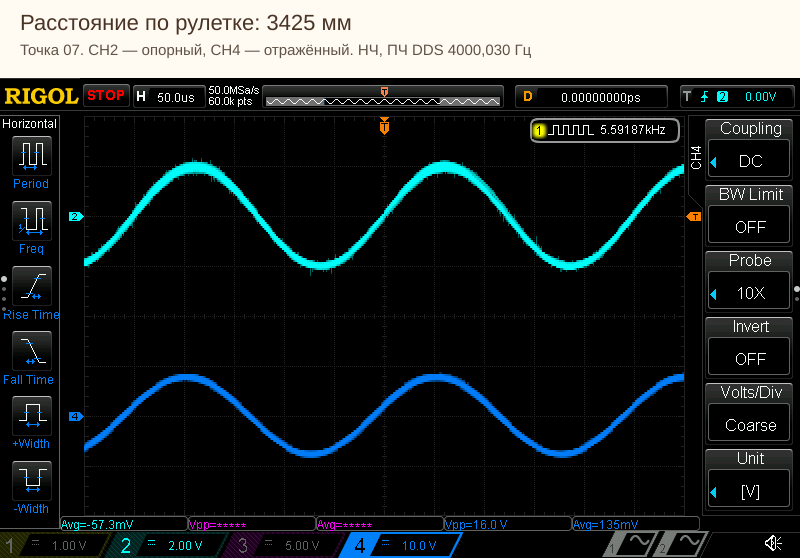

[Нативный PNG](point-07_03425.0mm_ch2-ch4.png)

## Точка 08 — 4198 мм

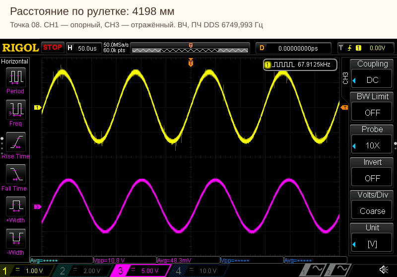

[Нативный PNG](point-08_04198.0mm_ch1-ch3.png)

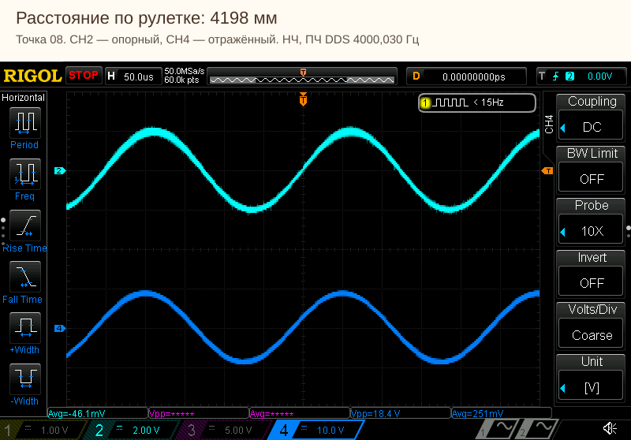

[Нативный PNG](point-08_04198.0mm_ch2-ch4.png)

## Точка 09 — 4814 мм

[Нативный PNG](point-09_04814.0mm_ch1-ch3.png)

[Нативный PNG](point-09_04814.0mm_ch2-ch4.png)

## Точка 10 — 5635 мм

[Нативный PNG](point-10_05635.0mm_ch1-ch3.png)

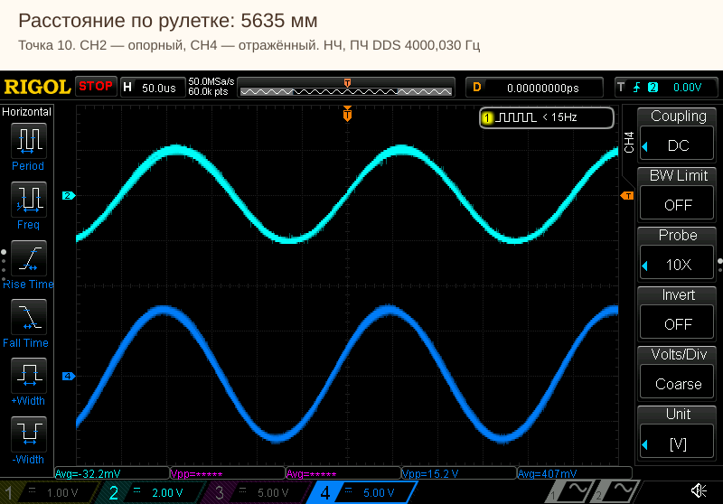

[Нативный PNG](point-10_05635.0mm_ch2-ch4.png)
